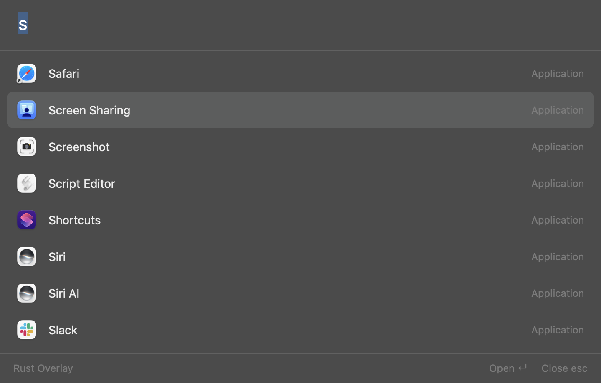

# rust-overlay

A Raycast-style launcher overlay for macOS, written in Rust directly against AppKit through the
[`objc2`](https://github.com/madsmtm/objc2) bindings. There's no web view, Electron or
cross-platform UI layer: it's native Cocoa windows and views, defined from Rust.



## Features

- **Global hotkey:** press <kbd>⌥ Space</kbd> from any app to open or close the launcher.
- **Doesn't steal focus:** the launcher is a non-activating floating panel, so the app you were
  using stays frontmost while you type.
- **Fuzzy search:** finds installed apps by prefix, initials (`vsc` finds Visual Studio Code),
  word or substring. Every query also offers a Google search as the last result.
- **Keyboard driven:** <kbd>↑</kbd> <kbd>↓</kbd> to move, <kbd>Return</kbd> to open,
  <kbd>Esc</kbd> to clear the query and then close. A click on a row also opens it.
- **Drag to move, with snapping:** drag any empty part of the panel. It snaps to the screen's
  center lines, its edges and its home position, showing dashed guide lines and a trackpad haptic
  tick. Hold <kbd>⌘</kbd> to place it freely.
- **Remembers its position** across launches and screens of different sizes.
- **Frosted-glass background** using the system's live blur material.
- **Menu bar icon** to open the launcher or quit, since the app has no Dock icon.

## Running

Requires macOS and a Rust toolchain ([rustup](https://rustup.rs)).

```bash
cargo run
```

The launcher opens on startup. Quit it from the menu bar icon or with <kbd>Ctrl</kbd>+<kbd>C</kbd>
in the terminal.

No special permissions are needed: the hotkey uses Carbon's `RegisterEventHotKey`, which doesn't
require Accessibility access.

To reset the saved position:

```bash
defaults delete rust-overlay
```

## How it's put together

| File | Purpose |
| --- | --- |
| `src/main.rs` | Starts `NSApplication` as an accessory app (no Dock icon, never takes focus). |
| `src/app.rs` | App delegate: menu bar item and the global hotkey. |
| `src/launcher.rs` | The floating panel, search field, keyboard handling, and dragging. |
| `src/results.rs` | The results list, drawn by hand with AppKit drawing calls. |
| `src/catalog.rs` | Finding installed apps and ranking search matches. Pure Rust. |
| `src/snap.rs` | Snapping and placement geometry. Pure Rust. |
| `src/guides.rs` | The click-through overlay window that draws dashed snap guides. |

The pure-Rust modules are unit tested:

```bash
cargo test
```
